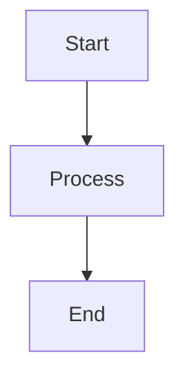

# Static Doc Template

A ready-to-use **static doc / knowledge base** template built with [Docusaurus 3](https://docusaurus.io/). Drop in your Markdown files, run one command, and get a fast, searchable, deployable site.

> English | [中文](./README.zh.md)

---

## Features

| Feature | Detail |
|---------|--------|
| **Markdown & MDX** | Write in plain `.md` or embed JSX components in `.mdx` |
| **View Source** | Every doc page has a `</> Source` button that reveals the raw Markdown inline |
| **Enhanced Mermaid** | Zoom, fullscreen overlay, JPG download, per-page theme override via frontmatter |
| **Diff highlighting** | `diff` code blocks with red/green line coloring |
| **Dark mode** | Follows system `prefers-color-scheme`; manual toggle available |
| **Full-text search** | Instant client-side search across all pages (Docusaurus built-in) |
| **Auto sidebar** | Sidebar is auto-generated from the `docs/` directory structure |
| **Responsive** | Works on desktop, tablet, and mobile |
| **Static output** | Pre-rendered HTML — deploy anywhere, no server required |

---

## Quick Start

Requires **Node.js ≥ 20**.

```bash
# 1. Clone and install
git clone <repo-url> my-doc
cd my-doc
npm install

# 2. Start the dev server (hot-reload)
npm start

# 3. Build for production
npm run build

# 4. Preview the production build locally
npm run serve
```

Open `http://localhost:3000` in your browser.

---

## Project Structure

```
├── docs/                          # Doc content — add your pages here
│   ├── index.md                   # Sidebar root / welcome page
│   ├── markdown-syntax.md         # Quick Markdown reference
│   ├── template.md                # Full syntax reference (English)
│   ├── template-zh.md             # Full syntax reference (Chinese)
│   ├── mermaid-examples.md        # Mermaid diagram showcase
│   └── examples/
│       └── hello-world.mdx        # Example MDX page with a React component
│
├── src/
│   ├── components/
│   │   ├── ExampleComponent/      # Sample custom component for MDX pages
│   │   └── ViewSource/            # "View Source" toggle button + raw Markdown panel
│   ├── context/
│   │   └── MermaidThemeContext.tsx # React context for per-page Mermaid theme
│   ├── css/custom.css             # Global CSS variables (colors, diff highlighting)
│   ├── pages/index.tsx            # Homepage with feature grid
│   └── theme/                     # Docusaurus swizzled components
│       ├── DocItem/Content/       # Wraps every doc page with <ViewSource>
│       ├── DocItem/Layout/        # Injects MermaidThemeProvider from frontmatter
│       ├── Footer/                # Compact 24px footer with version + copyright
│       ├── Mermaid/               # Enhanced Mermaid (zoom / fullscreen / download)
│       └── prismDiff.ts           # Registers the `diff` language with Prism
│
├── scripts/
│   └── copy-sources.mjs           # Pre-build: copies docs/*.md(x) → static/_source/
│
├── static/                        # Copied verbatim to build output
│   └── _source/                   # Auto-generated; do not edit manually
│
├── docusaurus.config.ts           # Site config (title, URL, navbar, plugins…)
├── sidebars.ts                    # Auto-generated sidebar from docs/
└── package.json
```

---

## Writing Pages

### 1. Create a file

Add any `.md` or `.mdx` file inside `docs/`. Nested directories become sidebar categories.

```
docs/
├── guide/
│   ├── _category_.json   # optional: set category label / position
│   └── overview.md
└── reference/
    └── api.md
```

### 2. Add frontmatter

```yaml
---
sidebar_position: 1        # order within the sidebar group
title: My Page             # overrides the first H1 as the sidebar label
description: SEO summary   # used in <meta> description
mermaidTheme: forest       # optional: per-page Mermaid theme
---
```

**Supported `mermaidTheme` values:** `default` · `neutral` · `forest` · `dark` · `base`

### 3. Write content

All standard Markdown is supported, plus Docusaurus extras:

- **Admonitions** — `:::note`, `:::tip`, `:::info`, `:::caution`, `:::danger`
- **Tabs** — `<Tabs>` / `<TabItem>` from `@theme/Tabs`
- **Collapsible blocks** — native HTML `<details>` / `<summary>`
- **Mermaid diagrams** — fenced ` ```mermaid ``` ` blocks
- **Diff code blocks** — fenced ` ```diff ``` ` with red/green coloring

See [`docs/template.md`](docs/template.md) for the complete reference (English) or [`docs/template-zh.md`](docs/template-zh.md) for the Chinese version.

---

## Using React Components in MDX

Any `.mdx` file can import and render React components:

```mdx
import ExampleComponent from '@site/src/components/ExampleComponent';

<ExampleComponent />
```

To add your own component, create it under `src/components/` and import it the same way.

---

## Mermaid Diagrams

Mermaid is enabled out of the box. Wrap your diagram in a fenced code block:

````markdown

````

### Per-page theme override

Set `mermaidTheme` in the page frontmatter to override the site-wide theme for that page:

```yaml
---
mermaidTheme: forest
---
```

### Three-level theme priority

| Priority | Source | Syntax |
|----------|--------|--------|
| Highest | Per-diagram `%%{init}` directive | `%%{init: {'theme':'forest'}}%%` |
| Medium | Frontmatter `mermaidTheme` | `mermaidTheme: forest` |
| Lowest | Site config `themeConfig.mermaid` | `theme: {light: 'default', dark: 'dark'}` |

### Enhanced Mermaid controls

Hover over any diagram to reveal the toolbar:

- **+** / **−** — zoom in / out
- **1:1** — reset zoom
- **↓** — download as JPG (device pixel ratio aware)
- **⤢** — fullscreen overlay (press `Esc` to close)

---

## View Source

Every doc page includes a **`</> Source`** button in the top-right corner. Clicking it fetches and displays the raw Markdown/MDX source of that page inline, without leaving the page.

**How it works:**

1. The `prebuild` script (`scripts/copy-sources.mjs`) copies all `.md` / `.mdx` files from `docs/` to `static/_source/` before every build.
2. `src/theme/DocItem/Content` wraps the rendered content with the `<ViewSource>` component.
3. `ViewSource` maps the document's source path to a `/_source/…` URL and fetches it on demand when the button is clicked.

The `static/_source/` directory is auto-generated — do not commit or edit it manually.

---

## Customization

### Colors

Edit CSS variables in `src/css/custom.css`:

```css
:root {
  --ifm-color-primary: #2563eb;   /* blue-600 (light mode) */
}
[data-theme='dark'] {
  --ifm-color-primary: #60a5fa;   /* blue-400 (dark mode) */
}
```

### Site metadata

Edit `docusaurus.config.ts`:

```ts
const config: Config = {
  title: 'My Doc',
  tagline: 'A static doc site built with Docusaurus',
  url: 'https://your-doc.example.com',
  // ...
};
```

### Navbar links

Add items to the `navbar.items` array in `docusaurus.config.ts`:

```ts
navbar: {
  items: [
    { type: 'docSidebar', sidebarId: 'tutorialSidebar', label: 'Pages' },
    { href: 'https://github.com/you/repo', label: 'GitHub', position: 'right' },
  ],
},
```

### Version number in footer

Set the version string in `customFields` inside `docusaurus.config.ts`:

```ts
customFields: {
  version: '1.0.0',
},
```

---

## Deployment

```bash
npm run build
```

The `build/` directory is a fully self-contained static site. Deploy it to any static hosting provider:

| Provider | Method |
|----------|--------|
| **GitHub Pages** | `npm run deploy` (requires `organizationName` + `projectName` in config) |
| **Netlify** | Drag-and-drop `build/` or connect the repo (build command: `npm run build`) |
| **Vercel** | Connect repo; set output directory to `build` |
| **Any CDN / S3** | Upload the contents of `build/` |

---

## Tech Stack

| Package | Version |
|---------|---------|
| Docusaurus | 3.10.1 |
| React | 19 |
| TypeScript | ~6.0 |
| `@docusaurus/theme-mermaid` | 3.10.1 |
| `prism-react-renderer` | 2.x |

---

## License

MIT
