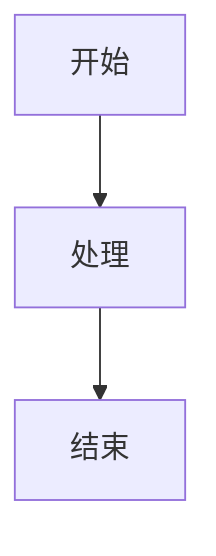

# 静态 Doc 模板

基于 [Docusaurus 3](https://docusaurus.io/) 构建的开箱即用**静态 Doc / 知识库**模板。将你的 Markdown 文件放进去，一条命令即可获得一个快速、可搜索、可部署的站点。

> [English](./README.md) | 中文

---

## 功能特性

| 功能 | 说明 |
|------|------|
| **Markdown & MDX** | 用 `.md` 编写纯文本，或在 `.mdx` 中嵌入 JSX 组件 |
| **查看源码** | 每个文档页面都有 `</> Source` 按钮，可内联展示原始 Markdown |
| **增强版 Mermaid** | 支持缩放、全屏预览、JPG 下载，以及通过 frontmatter 覆盖单页主题 |
| **Diff 高亮** | `diff` 代码块带红/绿行着色 |
| **深色模式** | 跟随系统 `prefers-color-scheme`，也可手动切换 |
| **全文搜索** | 基于客户端的即时搜索（Docusaurus 内置） |
| **自动侧边栏** | 根据 `docs/` 目录结构自动生成侧边栏 |
| **响应式布局** | 适配桌面、平板和移动端 |
| **静态输出** | 预渲染 HTML，随处可部署，无需服务器 |

---

## 快速开始

需要 **Node.js ≥ 20**。

```bash
# 1. 克隆并安装依赖
git clone <repo-url> my-doc
cd my-doc
npm install

# 2. 启动开发服务器（热重载）
npm start

# 3. 构建生产版本
npm run build

# 4. 本地预览生产构建
npm run serve
```

在浏览器中打开 `http://localhost:3000`。

---

## 项目结构

```
├── docs/                          # Doc 内容 — 在此添加你的页面
│   ├── index.md                   # 侧边栏根目录 / 欢迎页
│   ├── markdown-syntax.md         # Markdown 快速参考
│   ├── template.md                # 完整语法参考（英文）
│   ├── template-zh.md             # 完整语法参考（中文）
│   ├── mermaid-examples.md        # Mermaid 图表展示
│   └── examples/
│       └── hello-world.mdx        # 含 React 组件的示例 MDX 页面
│
├── src/
│   ├── components/
│   │   ├── ExampleComponent/      # MDX 页面示例组件
│   │   └── ViewSource/            # "查看源码"切换按钮 + 原始 Markdown 面板
│   ├── context/
│   │   └── MermaidThemeContext.tsx # 用于单页 Mermaid 主题的 React Context
│   ├── css/custom.css             # 全局 CSS 变量（颜色、diff 高亮）
│   ├── pages/index.tsx            # 首页（功能网格）
│   └── theme/                     # Docusaurus swizzle 组件
│       ├── DocItem/Content/       # 为每个文档页面包裹 <ViewSource>
│       ├── DocItem/Layout/        # 从 frontmatter 注入 MermaidThemeProvider
│       ├── Footer/                # 24px 紧凑页脚（版本号 + 版权）
│       ├── Mermaid/               # 增强版 Mermaid（缩放 / 全屏 / 下载）
│       └── prismDiff.ts           # 向 Prism 注册 `diff` 语言
│
├── scripts/
│   └── copy-sources.mjs           # 构建前：将 docs/*.md(x) 复制到 static/_source/
│
├── static/                        # 原样复制到构建输出
│   └── _source/                   # 自动生成，请勿手动编辑
│
├── docusaurus.config.ts           # 站点配置（标题、URL、导航栏、插件…）
├── sidebars.ts                    # 从 docs/ 自动生成的侧边栏
└── package.json
```

---

## 编写页面

### 1. 创建文件

在 `docs/` 目录下添加 `.md` 或 `.mdx` 文件。嵌套目录会自动成为侧边栏分类。

```
docs/
├── guide/
│   ├── _category_.json   # 可选：设置分类标签 / 顺序
│   └── overview.md
└── reference/
    └── api.md
```

### 2. 添加 frontmatter

```yaml
---
sidebar_position: 1        # 在侧边栏分组中的排序
title: 我的页面            # 覆盖侧边栏标签（默认取第一个 H1）
description: SEO 描述      # 用于 <meta> description
mermaidTheme: forest       # 可选：单页 Mermaid 主题
---
```

**`mermaidTheme` 可选值：** `default` · `neutral` · `forest` · `dark` · `base`

### 3. 编写内容

支持所有标准 Markdown，以及 Docusaurus 扩展语法：

- **提示框（Admonitions）** — `:::note`、`:::tip`、`:::info`、`:::caution`、`:::danger`
- **标签页（Tabs）** — 来自 `@theme/Tabs` 的 `<Tabs>` / `<TabItem>`
- **折叠块** — 原生 HTML `<details>` / `<summary>`
- **Mermaid 图表** — 围栏代码块 ` ```mermaid ``` `
- **Diff 代码块** — 围栏代码块 ` ```diff ``` `，带红/绿着色

完整参考请查看 [`docs/template.md`](docs/template.md)（英文）或 [`docs/template-zh.md`](docs/template-zh.md)（中文）。

---

## 在 MDX 中使用 React 组件

任意 `.mdx` 文件均可导入并渲染 React 组件：

```mdx
import ExampleComponent from '@site/src/components/ExampleComponent';

<ExampleComponent />
```

如需添加自定义组件，在 `src/components/` 下创建后以相同方式导入即可。

---

## Mermaid 图表

开箱即支持 Mermaid，将图表代码放入围栏代码块：

````markdown

````

### 单页主题覆盖

在页面 frontmatter 中设置 `mermaidTheme` 可覆盖该页的站点全局主题：

```yaml
---
mermaidTheme: forest
---
```

### 三级主题优先级

| 优先级 | 来源 | 写法 |
|--------|------|------|
| 最高 | 单图 `%%{init}` 指令 | `%%{init: {'theme':'forest'}}%%` |
| 中 | Frontmatter `mermaidTheme` | `mermaidTheme: forest` |
| 最低 | 站点配置 `themeConfig.mermaid` | `theme: {light: 'default', dark: 'dark'}` |

### 增强版 Mermaid 控件

将鼠标悬停在图表上即可显示工具栏：

- **+** / **−** — 放大 / 缩小
- **1:1** — 重置缩放
- **↓** — 下载为 JPG（支持高 DPR 屏幕）
- **⤢** — 全屏预览（按 `Esc` 关闭）

---

## 查看源码

每个文档页面右上角都有 **`</> Source`** 按钮。点击后即可在不离开当前页面的情况下，内联获取并显示该页面的原始 Markdown/MDX 源码。

**实现原理：**

1. `prebuild` 脚本（`scripts/copy-sources.mjs`）在每次构建前，将 `docs/` 下所有 `.md` / `.mdx` 文件复制到 `static/_source/`。
2. `src/theme/DocItem/Content` 用 `<ViewSource>` 组件包裹渲染后的内容。
3. `ViewSource` 将文档的源文件路径映射为 `/_source/…` URL，并在点击按钮时按需获取。

`static/_source/` 目录由脚本自动生成，请勿提交或手动编辑。

---

## 自定义

### 颜色

编辑 `src/css/custom.css` 中的 CSS 变量：

```css
:root {
  --ifm-color-primary: #2563eb;   /* blue-600（亮色模式）*/
}
[data-theme='dark'] {
  --ifm-color-primary: #60a5fa;   /* blue-400（深色模式）*/
}
```

### 站点元数据

编辑 `docusaurus.config.ts`：

```ts
const config: Config = {
  title: 'My Doc',
  tagline: '基于 Docusaurus 构建的静态 Doc 站点',
  url: 'https://your-doc.example.com',
  // ...
};
```

### 导航栏链接

在 `docusaurus.config.ts` 的 `navbar.items` 数组中添加条目：

```ts
navbar: {
  items: [
    { type: 'docSidebar', sidebarId: 'tutorialSidebar', label: '页面' },
    { href: 'https://github.com/you/repo', label: 'GitHub', position: 'right' },
  ],
},
```

### 页脚版本号

在 `docusaurus.config.ts` 的 `customFields` 中设置版本字符串：

```ts
customFields: {
  version: '1.0.0',
},
```

---

## 部署

```bash
npm run build
```

`build/` 目录是完全自包含的静态站点，可部署到任意静态托管服务：

| 平台 | 方式 |
|------|------|
| **GitHub Pages** | `npm run deploy`（需在配置中设置 `organizationName` + `projectName`） |
| **Netlify** | 拖拽上传 `build/` 目录，或连接仓库（构建命令：`npm run build`） |
| **Vercel** | 连接仓库，将输出目录设为 `build` |
| **CDN / S3** | 上传 `build/` 目录中的内容 |

---

## 技术栈

| 包 | 版本 |
|----|------|
| Docusaurus | 3.10.1 |
| React | 19 |
| TypeScript | ~6.0 |
| `@docusaurus/theme-mermaid` | 3.10.1 |
| `prism-react-renderer` | 2.x |

---

## 许可证

MIT
