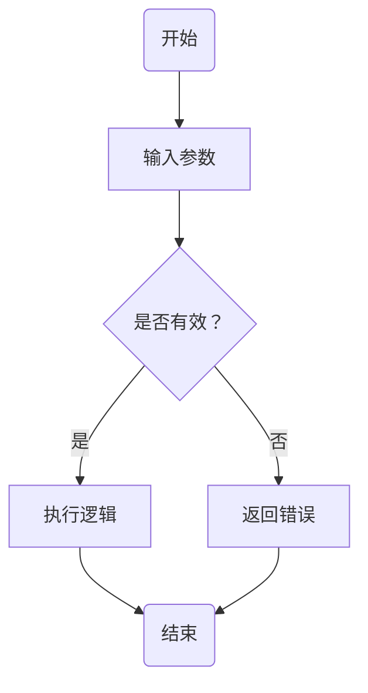
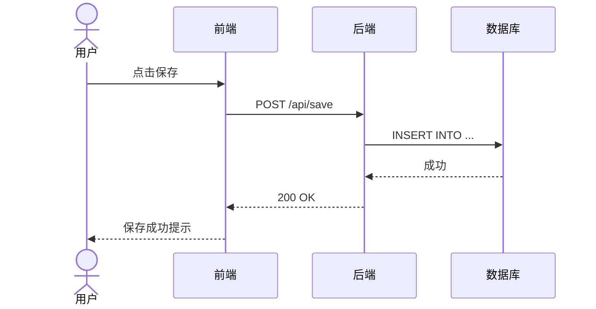
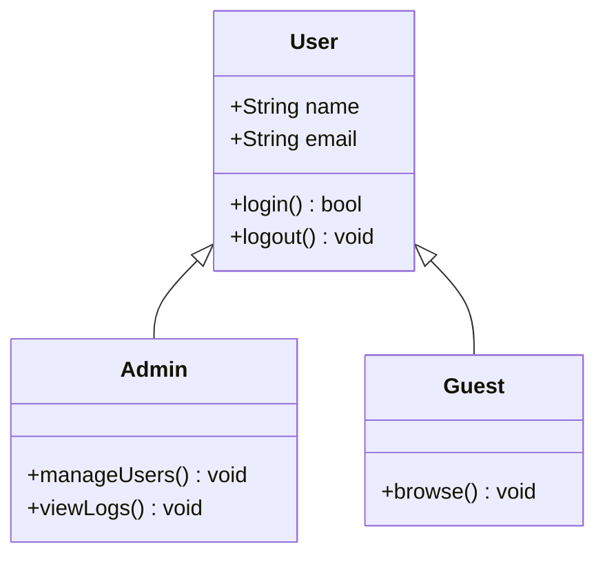
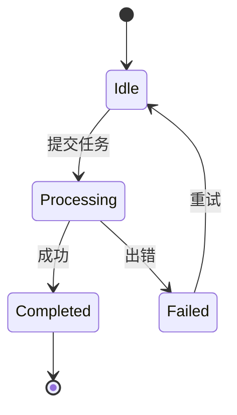
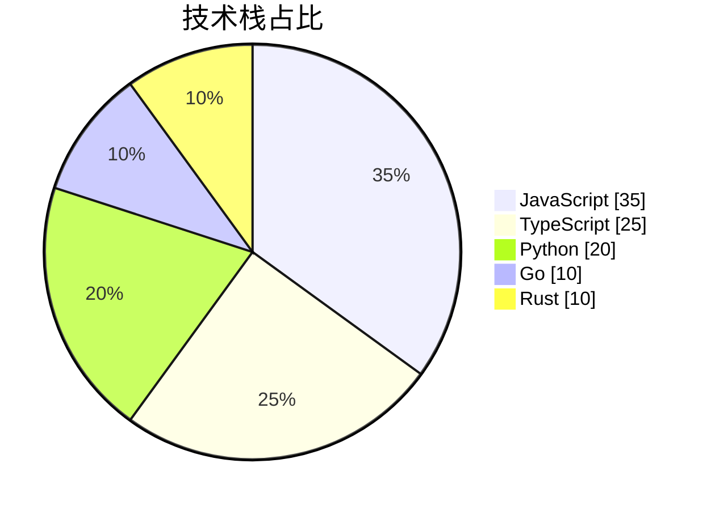
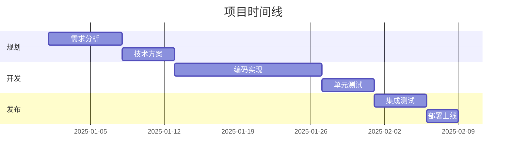
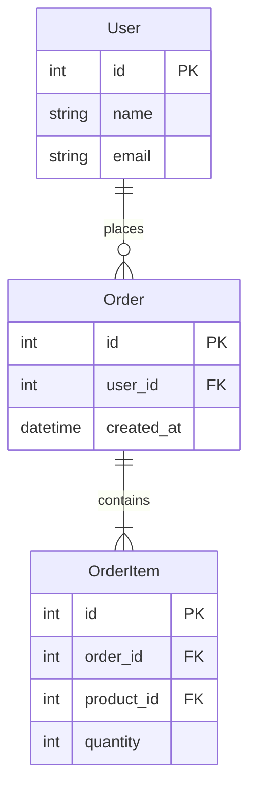
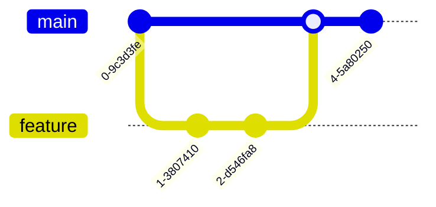
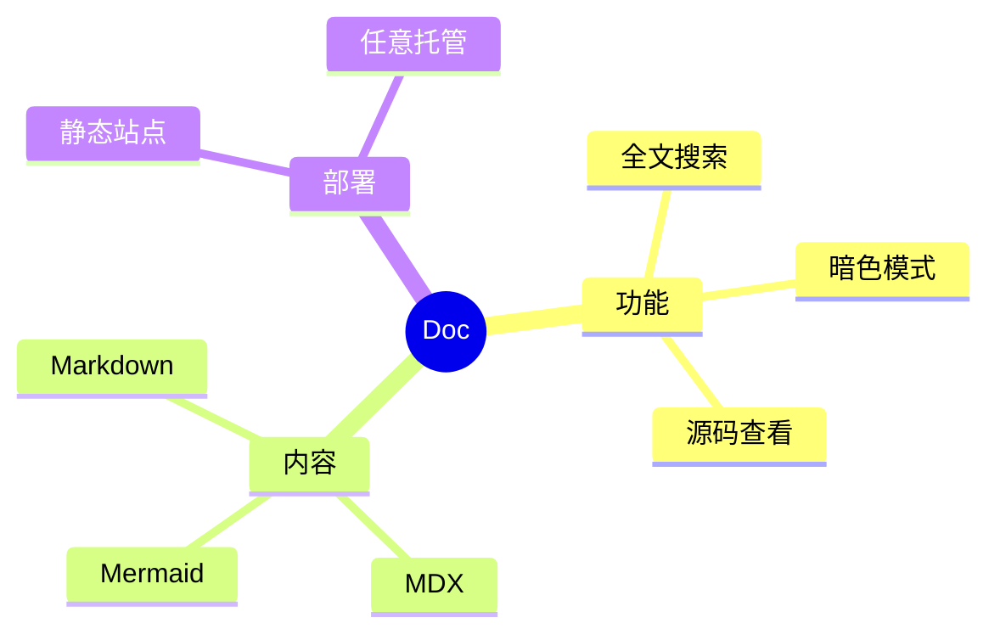
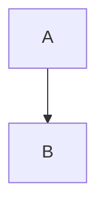

# Mermaid 图表示例

[Mermaid](https://mermaid.js.org/) 是一个基于文本的图表工具，用简短的脚本即可生成流程图、时序图、类图等。

---

## 流程图 (Flowchart)



## 时序图 (Sequence Diagram)



## 类图 (Class Diagram)



## 状态图 (State Diagram)



## 饼图 (Pie Chart)



## 甘特图 (Gantt Chart)



## 实体关系图 (ER Diagram)



## Git 分支图



## 思维导图 (Mindmap)



---

## 用法说明

在任意 `.md` 或 `.mdx` 文件中用围栏代码块包裹 Mermaid 脚本即可：

````markdown

````

> 更多语法参考 [Mermaid 官方文档](https://mermaid.js.org/syntax/)
