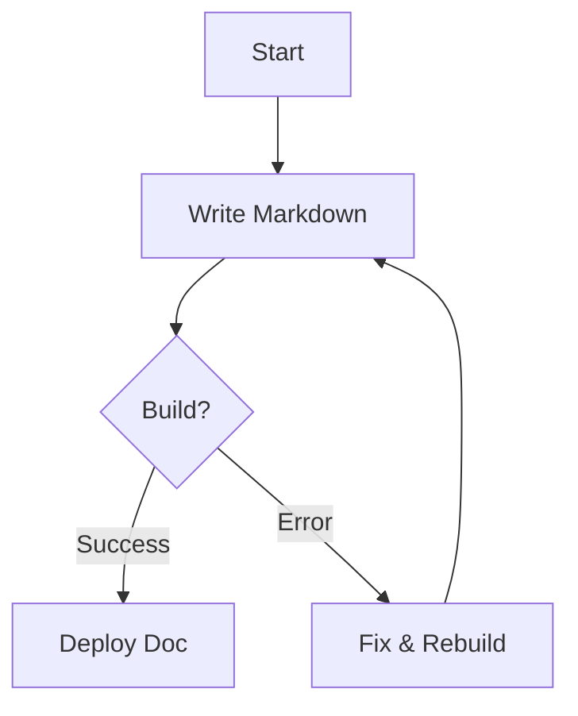
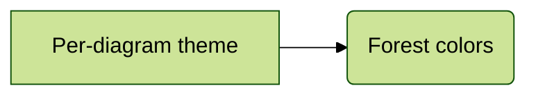

# Document Template

This document serves as a **complete reference** for all syntax and features available in this doc site. Use it as a template when creating new pages.

---

## Table of Contents

{/* TOC is auto-generated by Docusaurus on the right side */}

- [Text Formatting](#text-formatting)
- [Headings](#headings)
- [Lists](#lists)
- [Links & Images](#links--images)
- [Code](#code)
- [Blockquotes](#blockquotes)
- [Tables](#tables)
- [Frontmatter](#frontmatter)
- [Admonitions](#admonitions)
- [Tabs](#tabs)
- [MDX & Components](#mdx--components)
- [Math Equations](#math-equations)
- [Details / Collapsible](#details--collapsible)
- [Emoji & Special Characters](#emoji--special-characters)
- [Horizontal Rule](#horizontal-rule)
- [HTML](#html)

---

## Text Formatting

**Bold** | *Italic* | ~~Strikethrough~~ | `Inline code` | <u>Underline</u> (HTML) | H~2~O (subscript) | X^2^ (superscript)

## Headings

```markdown
# H1 — page title (use only one per page)
## H2 — major section
### H3 — subsection
#### H4 — sub-subsection
##### H5 — fine detail
###### H6 — footnote-level
```

## Lists

### Ordered

1. First item
2. Second item
   1. Nested 2.a
   2. Nested 2.b
3. Third item

### Unordered

- Item A
- Item B
  - Nested B.1
  - Nested B.2
- Item C

### Task List

- [x] Completed task
- [ ] Pending task
- [ ] Another pending task

### Definition List (HTML)

<dl>
  <dt>Wiki</dt>
  <dd>A website that allows collaborative editing of its content.</dd>
  <dt>Markdown</dt>
  <dd>A lightweight markup language for creating formatted text.</dd>
</dl>

## Links & Images

### Links

- External: [OpenCode](https://opencode.ai)
- Internal: [Welcome Page](/docs/)
- Internal (same-page anchor): [Jump to TOC](#table-of-contents)
- Auto-linked URL: https://docusaurus.io
- With title: [Docusaurus](https://docusaurus.io "Official docs")
- Same-page anchor: [Jump to TOC](#table-of-contents)

### Images


| Syntax  | Description |
|---------|-------------|
| `` | Inline image |
| `` | Image with hover title |
| `` tag | Full control via HTML |

## Code

### Inline Code

Use the `npx docusaurus start` command to run the dev server.

### Fenced Code Block

```javascript
// JavaScript example
function greet(name) {
  const message = `Hello, ${name}!`;
  console.log(message);
  return message;
}

greet('Wiki');
```

### Code Block with Title

```python title="hello.py"
def hello():
    print("Hello, Wiki!")
```

### Code Block with Line Highlighting

```go showLineNumbers {2-3,5}
package main

import "fmt"

func main() {
    fmt.Println("Hello, Wiki!")
}
```

### Diff-style

```diff
+ This line was added
- This line was removed
  This line stayed the same
```

### Mermaid Diagram



#### Theme Priority

Mermaid diagram themes follow a three-level priority system:

| Priority | Source | Example |
|----------|--------|---------|
| Highest | Per-diagram `%%{init}` | `%%{init: {'theme':'forest'}}%%` |
| Medium | Frontmatter `mermaidTheme` | `mermaidTheme: forest` |
| Lowest | Site config `themeConfig.mermaid` | `theme: {light: 'default'}` |

Available themes: `default`, `neutral`, `forest`, `dark`, `base`.



## Blockquotes

> This is a blockquote.
>
> It can span multiple paragraphs.
>
> > And can be **nested**.

## Tables

### Simple Table

| Feature       | Status | Version |
|---------------|--------|---------|
| Markdown      | ✅     | 1.0     |
| MDX           | ✅     | 1.0     |
| Admonitions   | ✅     | 2.0     |
| Mermaid       | ✅     | 3.0     |

### Column Alignment

| Left-aligned | Center-aligned | Right-aligned |
|:-------------|:--------------:|--------------:|
| Cell A       | Cell B         | Cell C        |
| Cell D       | Cell E         | Cell F        |

## Frontmatter

Every document starts with YAML frontmatter between `---` delimiters:

```yaml
---
sidebar_position: 10
title: Document Template
description: A reference document demonstrating all supported syntax
---
```

Common fields:

| Field              | Purpose |
|--------------------|---------|
| `sidebar_position` | Order in sidebar |
| `title`            | Override page title |
| `description`      | Meta description for SEO |
| `tags`             | Array of tags: `[guide, reference]` |
| `hide_table_of_contents` | Set `true` to hide TOC |
| `slug`             | Custom URL path |
| `mermaidTheme`     | Mermaid theme override: `default`, `forest`, `neutral`, `dark`, `base` |

## Admonitions

:::note
This is a **note** admonition. Use it for general information.
:::

:::tip
This is a **tip** admonition. Use it for best-practice suggestions.
:::

:::info
This is an **info** admonition. Use it for contextual details.
:::

:::caution
This is a **caution** admonition. Use it for warnings about potential issues.
:::

:::danger
This is a **danger** admonition. Use it for critical alerts.
:::

### Custom Title

:::note[My Custom Title]
You can override the default title with any text.
:::

## Tabs

import Tabs from '@theme/Tabs';
import TabItem from '@theme/TabItem';

<Tabs>
  <TabItem value="npm" label="npm" default>
    ```bash
    npm install @docusaurus/core
    ```
  </TabItem>
  <TabItem value="yarn" label="yarn">
    ```bash
    yarn add @docusaurus/core
    ```
  </TabItem>
  <TabItem value="pnpm" label="pnpm">
    ```bash
    pnpm add @docusaurus/core
    ```
  </TabItem>
</Tabs>

<Tabs groupId="os">
  <TabItem value="mac" label="macOS">Open **Terminal.app**</TabItem>
  <TabItem value="linux" label="Linux">Open your preferred terminal emulator</TabItem>
  <TabItem value="win" label="Windows">Open **PowerShell** or **CMD**</TabItem>
</Tabs>

## MDX & Components

### Import and Use a Component

import ExampleComponent from '@site/src/components/ExampleComponent';

<ExampleComponent />

### JSX in Markdown

You can embed **any** JSX expression directly:

<p style={{ color: 'var(--ifm-color-primary)', fontWeight: 'bold', fontSize: '1.1rem' }}>
  This paragraph is styled with inline JSX!
</p>

### Custom Component with Props

<ExampleComponent />

> MDX files (`.mdx`) support all of the above. Regular `.md` files support everything except JSX imports and expressions.

## Math Equations

### Inline Math

When `$a \ne 0$`, there are two solutions to `$ax^2 + bx + c = 0$` and they are:

### Display Math (requires remark-math plugin)

```text
$$ x = {-b \pm \sqrt{b^2 - 4ac} \over 2a} $$
```

:::note
Math rendering requires the `remark-math` and `rehype-katex` plugins. If these aren't enabled, the LaTeX will display as plain text.
:::

## Details / Collapsible

<details>
  <summary>Click to expand</summary>

This content is hidden by default. Supports **Markdown** inside.

```json
{
  "key": "value",
  "nested": true
}
```

</details>

## Emoji & Special Characters

:rocket: :book: :warning: :white_check_mark: :x: :memo:

| Emoji | Shortcode |
|-------|-----------|
| 🚀 | `:rocket:` |
| ✅ | `:white_check_mark:` |
| 📝 | `:memo:` |

## Horizontal Rule

Use three or more dashes, asterisks, or underscores:

---

## HTML

Raw HTML is supported in both `.md` and `.mdx` files:

<div style={{
  border: '2px dashed var(--ifm-color-primary)',
  borderRadius: '8px',
  padding: '1rem',
  textAlign: 'center',
  background: 'var(--ifm-background-surface-color)',
}}>
  <p style={{margin: 0}}>This is a <strong>custom HTML block</strong> styled inline.</p>
  <p style={{margin: '0.5rem 0 0', fontSize: '0.85rem', opacity: 0.7}}>Supports any valid HTML.</p>
</div>

<br/>

<kbd>Ctrl</kbd> + <kbd>C</kbd> — keyboard shortcut example.

---

## Viewing This Page's Source

At the bottom of this page, click the **`</> Source`** button to see the raw Markdown/MDX content of this page — the exact file that generates what you're reading now.

Use that feature on any doc page to learn from existing examples.
