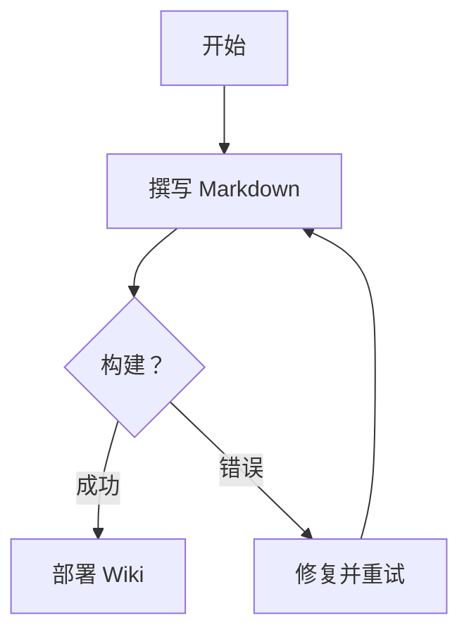

# 文档模板

本文档作为**完整参考**，展示本 wiki 支持的所有语法与功能。创建新页面时可将其作为模板使用。

---

## 目录

- [文本格式](#文本格式)
- [标题](#标题)
- [列表](#列表)
- [链接与图片](#链接与图片)
- [代码](#代码)
- [引用](#引用)
- [表格](#表格)
- [前置元数据](#前置元数据)
- [提示框](#提示框)
- [选项卡](#选项卡)
- [MDX 与组件](#mdx-与组件)
- [数学公式](#数学公式)
- [折叠块](#折叠块)
- [Emoji 与特殊字符](#emoji-与特殊字符)
- [分隔线](#分隔线)
- [HTML](#html)

---

## 文本格式

**粗体** | *斜体* | ~~删除线~~ | `行内代码` | <u>下划线</u>（HTML） | H~2~O（下标） | X^2^（上标）

## 标题

```markdown
# H1 — 页面标题（每页只用一次）
## H2 — 主要章节
### H3 — 子章节
#### H4 — 子子章节
##### H5 — 细节目录
###### H6 — 脚注级别
```

## 列表

### 有序列表

1. 第一项
2. 第二项
   1. 嵌套项 2.a
   2. 嵌套项 2.b
3. 第三项

### 无序列表

- 项目 A
- 项目 B
  - 嵌套 B.1
  - 嵌套 B.2
- 项目 C

### 任务列表

- [x] 已完成任务
- [ ] 待办任务
- [ ] 另一个待办任务

### 定义列表（HTML）

<dl>
  <dt>Wiki</dt>
  <dd>一种允许多人协作编辑内容的网站。</dd>
  <dt>Markdown</dt>
  <dd>一种轻量级标记语言，用于编写格式化文本。</dd>
</dl>

## 链接与图片

### 链接

- 外部链接：[OpenCode](https://opencode.ai)
- 内部链接：[首页](/docs/)
- 锚点跳转：[跳转至目录](#目录)
- 自动链接：https://docusaurus.io
- 带标题的链接：[Docusaurus](https://docusaurus.io "官方文档")

### 图片


| 语法 | 说明 |
|------|------|
| `` | 行内图片 |
| `` | 带悬停标题的图片 |
| `` 标签 | 完全控制的 HTML 方式 |

## 代码

### 行内代码

使用 `npx docusaurus start` 命令启动开发服务器。

### 围栏代码块

```javascript
// JavaScript 示例
function greet(name) {
  const message = `你好，${name}！`;
  console.log(message);
  return message;
}

greet('Wiki');
```

### 带标题的代码块

```python title="hello.py"
def hello():
    print("你好，Wiki！")
```

### 行高亮

```go showLineNumbers {2-3,5}
package main

import "fmt"

func main() {
    fmt.Println("你好，Wiki！")
}
```

### Diff 风格

```diff
+ 这行是新增的
- 这行被删除了
  这行保持不变
```

### Mermaid 图表



#### 主题优先级

Mermaid 图表主题遵循三级优先级：

| 优先级 | 来源 | 示例 |
|--------|------|------|
| 最高 | 图表内 `%%{init}` | `%%{init: {'theme':'forest'}}%%` |
| 中等 | 前置元数据 `mermaidTheme` | `mermaidTheme: forest` |
| 最低 | 站点配置 `themeConfig.mermaid` | `theme: {light: 'default'}` |

可用主题：`default`、`neutral`、`forest`、`dark`、`base`。


## 引用

> 这是一条引用。
>
> 可跨多段落。
>
> > 支持**嵌套**。

## 表格

### 简单表格

| 功能         | 状态 | 版本 |
|--------------|------|------|
| Markdown     | ✅   | 1.0  |
| MDX          | ✅   | 1.0  |
| 提示框       | ✅   | 2.0  |
| Mermaid      | ✅   | 3.0  |

### 列对齐

| 左对齐        | 居中对齐       | 右对齐         |
|:--------------|:--------------:|---------------:|
| 单元格 A      | 单元格 B       | 单元格 C       |
| 单元格 D      | 单元格 E       | 单元格 F       |

## 前置元数据

每个文档以 YAML 前置元数据开头，位于 `---` 分隔符之间：

```yaml
---
sidebar_position: 11
title: 文档模板（中文）
description: 展示本 wiki 所有受支持语法和功能的参考文档
---
```

常用字段：

| 字段                     | 用途 |
|--------------------------|------|
| `sidebar_position`       | 侧边栏排序 |
| `title`                  | 覆盖页面标题 |
| `description`            | Meta 描述（用于 SEO） |
| `tags`                   | 标签数组，如 `[指南, 参考]` |
| `hide_table_of_contents` | 设为 `true` 隐藏目录 |
| `slug`                   | 自定义 URL 路径 |
| `mermaidTheme`           | Mermaid 主题覆盖：`default`、`forest`、`neutral`、`dark`、`base` |

## 提示框

:::note
这是一个 **note** 提示框，用于一般信息。
:::

:::tip
这是一个 **tip** 提示框，用于最佳实践建议。
:::

:::info
这是一个 **info** 提示框，用于上下文补充说明。
:::

:::caution
这是一个 **caution** 提示框，用于潜在问题警告。
:::

:::danger
这是一个 **danger** 提示框，用于严重警报。
:::

### 自定义标题

:::note[我的自定义标题]
你可以将默认标题替换为任意文本。
:::

## 选项卡

import Tabs from '@theme/Tabs';
import TabItem from '@theme/TabItem';

<Tabs>
  <TabItem value="npm" label="npm" default>
    ```bash
    npm install @docusaurus/core
    ```
  </TabItem>
  <TabItem value="yarn" label="yarn">
    ```bash
    yarn add @docusaurus/core
    ```
  </TabItem>
  <TabItem value="pnpm" label="pnpm">
    ```bash
    pnpm add @docusaurus/core
    ```
  </TabItem>
</Tabs>

<Tabs groupId="os">
  <TabItem value="mac" label="macOS">打开 **Terminal.app**</TabItem>
  <TabItem value="linux" label="Linux">打开你使用的终端模拟器</TabItem>
  <TabItem value="win" label="Windows">打开 **PowerShell** 或 **CMD**</TabItem>
</Tabs>

## MDX 与组件

### 导入并使用组件

import ExampleComponent from '@site/src/components/ExampleComponent';

<ExampleComponent />

### 在 Markdown 中使用 JSX

可以直接嵌入**任意** JSX 表达式：

<p style={{ color: 'var(--ifm-color-primary)', fontWeight: 'bold', fontSize: '1.1rem' }}>
  这一行使用行内 JSX 设置了样式！
</p>

### 带属性的自定义组件

<ExampleComponent />

> MDX 文件（`.mdx`）支持以上所有语法。普通 `.md` 文件支持除 JSX 导入和表达式之外的所有内容。

## 数学公式

### 行内公式（需 remark-math 插件）

`$a \ne 0$` 时，`$ax^2 + bx + c = 0$` 有两个解：

### 块级公式

```text
$$ x = {-b \pm \sqrt{b^2 - 4ac} \over 2a} $$
```

:::note
数学公式渲染需要安装 `remark-math` 和 `rehype-katex` 插件。若未启用，LaTeX 将显示为纯文本。
:::

## 折叠块

<details>
  <summary>点击展开</summary>

隐藏的详细内容，支持 **Markdown** 语法。

```json
{
  "key": "value",
  "nested": true
}
```

</details>

## Emoji 与特殊字符

:rocket: :book: :warning: :white_check_mark: :x: :memo: :cn:

| Emoji | 快捷码 |
|-------|--------|
| 🚀 | `:rocket:` |
| ✅ | `:white_check_mark:` |
| 📝 | `:memo:` |
| 🇨🇳 | `:cn:` |

## 分隔线

使用三个或更多短横线、星号或下划线：

---

## HTML

`.md` 和 `.mdx` 文件均支持原始 HTML：

<div style={{
  border: '2px dashed var(--ifm-color-primary)',
  borderRadius: '8px',
  padding: '1rem',
  textAlign: 'center',
  background: 'var(--ifm-background-surface-color)',
}}>
  <p style={{margin: 0}}>这是一个<strong>自定义 HTML 块</strong>，通过行内样式设置。</p>
  <p style={{margin: '0.5rem 0 0', fontSize: '0.85rem', opacity: 0.7}}>支持任意合法 HTML。</p>
</div>

<br/>

<kbd>Ctrl</kbd> + <kbd>C</kbd> — 键盘快捷键示例。

---

## 查看本页源码

滚动到本页底部，点击 **`</> Source`** 按钮，即可看到当前页面的原始 Markdown/MDX 源码——也就是你正在阅读的这个页面所对应的原始文件。

在任何 wiki 页面使用该功能，可以从已有示例中学习。
